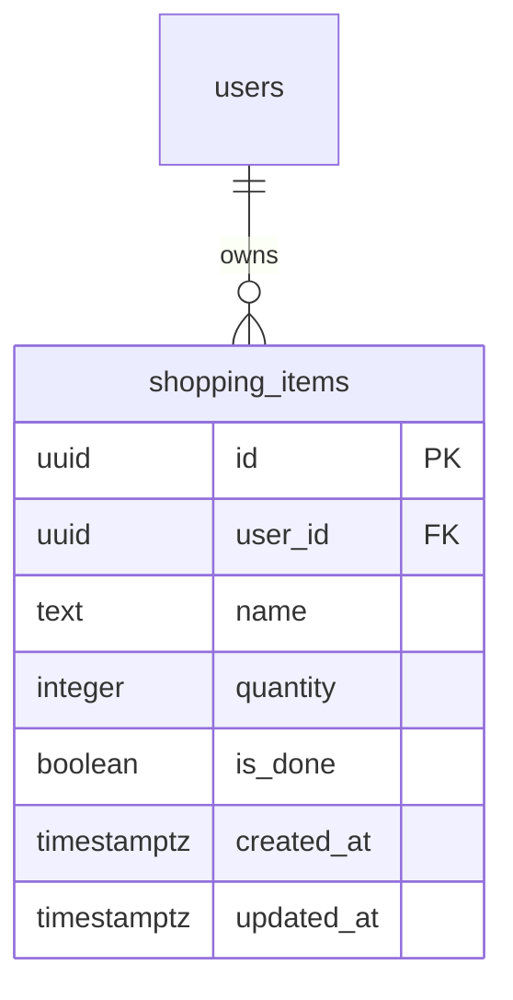

# daftar-belanja

## 1. Context & Goal

Aplikasi daftar belanja pribadi: user yang login mencatat barang yang perlu dibeli, menandainya sudah dibeli, dan membersihkan barang yang sudah dibeli. Proyek ini dibuat dari template starter Profil A.

Tujuan: satu fitur `shopping` dari database sampai UI Flutter, mengikuti `docs/conventions.md`, lalu fitur contoh notes dihapus.

## 2. Scope

### In scope

- Fitur `shopping`: tambah, lihat (dengan filter status dan pagination), ubah, tandai sudah/belum dibeli, hapus satu barang, hapus semua barang yang sudah dibeli.
- Nama barang unik per user tanpa membedakan huruf besar dan kecil.
- Menghapus fitur contoh notes dan menjadikan daftar belanja halaman utama.

### Non-goals

- Berbagi daftar dengan user lain.
- Kategori, harga, atau toko.
- Notifikasi dan pengingat.

## 3. Tech Constraints

Mengikuti `docs/conventions.md` sepenuhnya. Tidak ada library baru kecuali benar-benar diperlukan; bila ada, catat alasannya di log.

## 4. Data Model

Aturan:

- `name`: 1–80 karakter setelah di-trim; unik per user tanpa membedakan huruf besar dan kecil.
- `quantity`: bilangan bulat 1–999, default 1.
- `is_done`: default `false`.
- Hapus user menghapus barangnya.

## 5. API Contract

| Method dan path | Akses | Request | Response |
| --- | --- | --- | --- |
| GET /v1/shopping-items | pemilik | query `limit`, `cursor`, `status` (`all`, `open`, `done`; default `all`) | `200` halaman `ShoppingItem` |
| POST /v1/shopping-items | pemilik | `{ name, quantity? }` | `201 ShoppingItem`; `409` bila nama sudah ada |
| PATCH /v1/shopping-items/{id} | pemilik | `{ name?, quantity?, isDone? }` minimal satu field | `200 ShoppingItem`; `404`; `409` bila nama baru sudah ada |
| DELETE /v1/shopping-items/{id} | pemilik | — | `204`; `404` |
| POST /v1/shopping-items/clear-done | pemilik | — | `200 { deletedCount }` |

`ShoppingItem`: `{ id, name, quantity, isDone, createdAt, updatedAt }`. Urutan daftar: terbaru dulu. Format error mengikuti `docs/conventions.md`.

## 6. Functional Requirements

### FR-01: Tambah barang

Acceptance criteria:
- [ ] Given nama baru, When ditambahkan tanpa `quantity`, Then tersimpan dengan `quantity` 1 dan `isDone` false.
- [ ] Given "Telur" sudah ada, When menambah "telur", Then `409` dan tidak ada barang baru.
- [ ] Given nama berisi spasi saja atau lebih dari 80 karakter, When ditambahkan, Then `422` dengan `details.name`.

### FR-02: Lihat dan filter

Acceptance criteria:
- [ ] Given 25 barang campuran, When dibaca per 10 dengan `status=open`, Then hanya barang yang belum dibeli muncul, tanpa duplikat, dan halaman terakhir tidak punya halaman berikutnya.
- [ ] Given barang milik user lain, When daftar dibaca, Then barang itu tidak muncul.

### FR-03: Ubah dan tandai

Acceptance criteria:
- [ ] Given barang milik sendiri, When `isDone` diubah, Then status tersimpan dan field lain tidak berubah.
- [ ] Given nama diubah menjadi nama barang lain milik sendiri, When disimpan, Then `409`.
- [ ] Given barang milik user lain, When diubah atau dihapus, Then `404`.

### FR-04: Hapus yang sudah dibeli

Acceptance criteria:
- [ ] Given 3 barang sudah dibeli dan 2 belum, When `clear-done`, Then `deletedCount` 3 dan 2 barang tersisa.
- [ ] Given barang sudah dibeli milik user lain, When `clear-done`, Then barang itu tidak terhapus.

### FR-05: Aplikasi Flutter

Acceptance criteria:
- [ ] Given sudah login, When aplikasi dibuka, Then halaman daftar belanja tampil sebagai halaman utama.
- [ ] Given daftar, When filter Semua, Belum, dan Sudah dipilih, Then isi daftar sesuai filter.
- [ ] Given barang, When checkbox ditekan, Then status berubah dan tetap benar setelah daftar dimuat ulang.
- [ ] Given nama yang sudah ada, When disimpan, Then pesan "Barang ini sudah ada di daftar." tampil di field nama.
- [ ] Given ada barang sudah dibeli, When "Hapus yang sudah dibeli" dikonfirmasi, Then barang itu hilang dari daftar.

### FR-06: Hapus fitur contoh notes

Acceptance criteria:
- [ ] Given proyek, When fitur notes dihapus, Then tidak ada lagi kode, route, tabel, atau test notes, dan `pnpm check` tetap hijau.

## 7. Non-Functional Requirements

- **NFR-01:** semua endpoint baru wajib login (test keamanan route yang sudah ada harus otomatis mencakupnya).
- **NFR-02:** setiap use case punya unit test.

## 8. Assumptions & Decisions

| ID | Keputusan | Alasan |
| --- | --- | --- |
| D-01 | Nama barang yang duplikat dijawab `409 CONFLICT` | Memakai kode error yang sudah ada di kontrak |
| D-02 | Fitur notes dihapus setelah fitur shopping berdiri | Sesuai panduan di `docs/conventions.md` |

### Open Questions

- Tidak ada.
